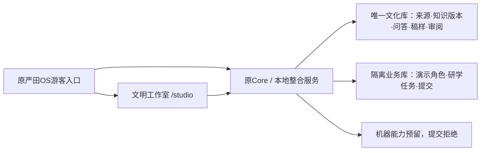

# 严田OS本地整合版

原游客Next应用是总入口；原Core承载文化服务，文明工作室挂载为`/studio`。
当前是单机本地运行版本，无生成式模型或专属训练权重。机器接口保留且关闭。

## 复用与共享

- 保留原游客首页、NPC对话与引用展示、纠错、研学任务、任务提交状态和健康页。
- 首页增加文化知识、出处问答、木刻稿样及工艺审阅四个入口。
- Core只创建一个CultureService；工作室、旧知识API、NPC服务及两项旧检索工具
  读取同一个版本库。保持原知识ID、出处、范围、权利与版本。
- 旧knowledge_entries与evidences不作为本地整合版的独立可写知识副本。
- 图样、知识版本、审阅和候选共用SQLite事务。更新知识或图样后须按新版本重新审阅。
- 原业务数据使用专用PostgreSQL与Redis；角色和研学任务明确标为演示配置。
  测试提交进入独立测试库，不能当作用户运营或真实工艺师意见。



## 本机运行

需要Python3.11+、Node及PostgreSQL14+、Redis。Core安装其pyproject依赖，
其中qdrant-client用于兼容原模块导入，本地模式不连接Qdrant。

```sh
cd apps/visitor-h5
npm ci --ignore-scripts --no-audit --no-fund
NEXT_PUBLIC_LOCAL_OS_MODE=1 YANTIAN_LOCAL_CORE_URL=http://127.0.0.1:8793 npm run build
cd ../..
python3 scripts/local_os.py prepare --state-dir /absolute/path/to/local-state
python3 scripts/local_os.py start --state-dir /absolute/path/to/local-state --culture-db /absolute/path/to/studio.sqlite3
```

入口默认`http://127.0.0.1:8791`，工作室在`/studio`。通过同一域代理，前端不直接跨源访问Core。
脚本显式覆写两套原数据库引擎的配置，不读取原环境文件；只绑定本机。
`stop`只停止本地所有者标识和启动指纹匹配的本整合版进程，保留数据。
未选定文化库路径时会在本地状态目录新建起始库，既有记录续用必须传入原路径。

## 数据与初始化边界

交付主机继续使用上一版工作室的同一个SQLite文件，不导入测试记录，不复制第二份可编辑知识。
运行前对原文件作本地备份并比对导出记录集合，切换后应保持内容和版本相同。
程序包不包含工作数据库、环境文件、依赖目录或运行日志。页面可导出JSON；本版没有导入恢复向导。

历史Alembic链有独立根p26，其后p27会在新库创建trace_ledger前修改该表。
本轮专用库使用已声明模型的元数据副本初始化，兼容旧/新模型客户端默认值，
并修正副本中UUID默认表达式。没有改动或标记生产迁移，也未连接已有业务库。
此初始化路径只用于专用本地库，不能当作生产升级脚本。

## 验收

Core独立测试在`services/core-backend/local_tests`；Studio测试使用临时SQLite。
不要运行原Core的旧`tests/conftest.py`：它指向固定测试库并执行drop_all。
`scripts/test_local_os_http.py`只用于独立验收数据库；默认运行库不可用它填充测试数据。
工作室另有`tests/acceptance_http.py`，挂载后仍可将base URL设为`/studio`。

本地profile关闭旧IoT命令、工作室机器、向量检索和embedding外呼。真实设备、多人登录、
身份认证、生成模型、生产发布和历史私有资料导入均须另有实现与验收。

## 住宿与体验运营模块

原首页增加 `/operations` 入口，`/stay` 是本地商品及咨询预览。
运营数据使用 `--state-dir/operations.sqlite3`（可用 `--operations-db` 覆写），与原文化库分开保存。
完整操作、初始事实与边界见 [local-operations.md](local-operations.md)。

内容与获客入口 `/growth` 串联产品、素材、视频生产资料、审阅、分发声明和原台账归因，见 [local-growth.md](local-growth.md)。

## 第二层离线成片

在原Core Python3.11环境另安装 `requirements-local-render.txt`（Pillow11.3.0），并确保FFmpeg/FFprobe与中文字体可读。本机已使用独立 `python-deps` 加载Pillow，不向原虚拟环境安装。生成入口在视频脚本编辑器下方：保存版本→确认脚本分镜→生成→预览/下载。后台任务和产物在本地数据中持久化，程序包不包含它们；停机不删除结果，中断可显式重试。成片是本地预览，不自动发布。
